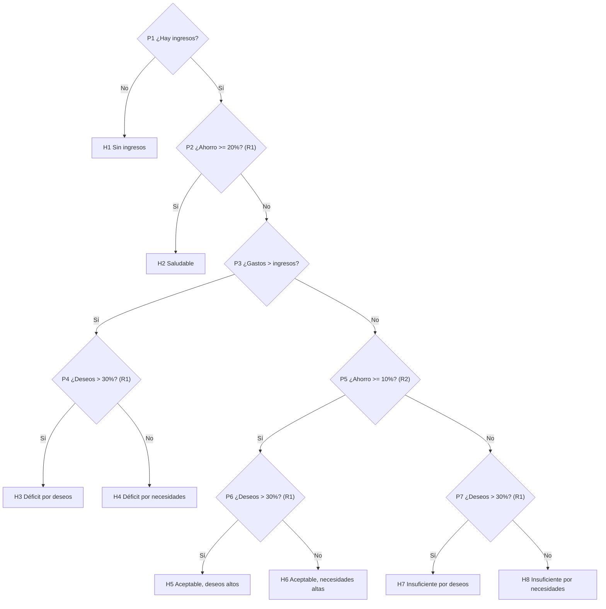
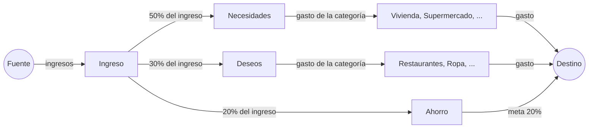

# Motor experto de FinanzasAI

Este documento explica cómo está construido el sistema experto, por qué se tomó cada decisión y dónde vive cada parte en el código. Sirve como guía para la exposición y el video.

## 1. Problema detectado

Llevo registro de mis gastos, pero no sé qué decisiones tomar para alcanzar mi meta de ahorro de la quincena sin sacrificar lo esencial. El sistema responde dos preguntas:

1. **¿Cómo va mi quincena?** Diagnóstico con árbol de decisión y explicación del razonamiento.
2. **¿Qué recorto para llegar a la meta con el menor sacrificio?** Plan de recortes encontrado con búsqueda exhaustiva y heurística, que además aprende de mis rechazos.

## 2. Componentes y dónde están

| Componente | Qué hace | Código |
|---|---|---|
| Base de hechos | Ingresos y gastos por categoría de la quincena actual | `Domain/Experto/HechosQuincena.cs` |
| Base de conocimiento | Reglas R1 a R3 con fuente, umbrales y clasificación de categorías | `Domain/Experto/BaseConocimiento.cs` |
| Motor de inferencia | Árbol de decisión binario | `Domain/Experto/Inferencia/ArbolDiagnostico.cs` |
| Módulo de explicación | Camino recorrido en el árbol, con la observación y la regla de cada paso | `ArbolDiagnostico.Diagnosticar` |
| Búsqueda de soluciones | Espacio de estados, BFS exhaustiva y A* | `Domain/Experto/Busqueda/` |
| Aprendizaje | Peso de sacrificio por categoría que crece con cada rechazo | `Domain/Experto/Aprendizaje/PesoSacrificio.cs` |
| Teoremas de flujo | Flujo máximo (Edmonds-Karp) y corte mínimo de la distribución del ingreso | `Domain/Experto/Flujo/` |
| Interfaz | Pestañas Movimientos, Diagnóstico, Plan de recortes y Flujo del ingreso | `frontend/src/` |

Todo el motor vive en `FinanzasAI.Domain`, sin base de datos ni HTTP, y se prueba con xUnit en `FinanzasAI.Tests/Experto/`. La Api solo carga los movimientos, llama al motor y devuelve el resultado.

## 3. Base de conocimiento

### Reglas con fuente

| Código | Regla | Fuente |
|---|---|---|
| R1 | Regla 50/30/20: hasta 50% del ingreso para necesidades, hasta 30% para deseos y al menos 20% para ahorro. Comer fuera, entretenimiento y suscripciones son deseos. | Warren, E. y Warren Tyagi, A. (2005). *All Your Worth: The Ultimate Lifetime Money Plan*. Free Press. |
| R2 | Ahorrar al menos 10% del ingreso como punto de partida. | CONDUSEF, citada en Expansión, ["Cómo pagar deudas según Condusef"](https://expansion.mx/finanzas-personales/2021/11/04/como-pagar-deudas-segun-condusef) (4 de noviembre de 2021). |
| R3 | Recortar los gastos prescindibles de forma paulatina, sin eliminarlos por completo. | CONDUSEF sobre gastos hormiga, citada en Expansión, ["Eliminar gastos hormiga"](https://expansion.mx/finanzas-personales/2022/02/18/eliminar-gastos-hormiga) (18 de febrero de 2022). |

**Nota sobre R2 y R3.** Las dos citan a CONDUSEF a través de notas de prensa. Se buscó el texto en publicaciones propias de CONDUSEF (los folletos "Consejos para tu bolsillo" en PDF), pero no se pudo extraer y verificar la frase exacta, así que se deja la cita de prensa, que sí es verificable. Si se ubica la publicación original, basta con cambiar el texto de la fuente en `BaseConocimiento.cs`.

### Cómo se usan las reglas

- **Clasificación de categorías (R1).** Las necesidades son Vivienda, Supermercado, Transporte, Servicios, Salud y Educación; son esenciales y no se recortan. Los deseos son Restaurantes, Entretenimiento, Ropa, Suscripciones y Otros. La categoría original "Comida" se separó en Supermercado y Restaurantes porque mezclaba una necesidad con un deseo.
- **Umbrales del árbol.** Ahorro de al menos 20% (R1), ahorro de al menos 10% (R2) y deseos de hasta 30% (R1).
- **Meta de ahorro.** 20% del ingreso por defecto (R1); el usuario la puede cambiar.
- **Niveles de recorte (R3).** Cada deseo se puede recortar 0%, 25%, 50% o 75%. Nunca se llega a 100%, así que siempre queda al menos 25% de la categoría.

### Parámetros de diseño (no son reglas financieras)

Estos valores no salen de una fuente: son decisiones de diseño de la simulación.

- **Peso inicial de sacrificio = 1.** Sin información del usuario, recortar un peso cuesta lo mismo en cualquier categoría.
- **Factor de rechazo = 2.** Cada rechazo duplica el costo de recortar esa categoría. Se eligió duplicar para que el efecto se vea con uno o dos rechazos en la demostración.

## 4. Árbol de decisión

### Por qué las preguntas van en este orden

1. **Primero lo que invalida el análisis.** Sin ingresos no se pueden calcular porcentajes.
2. **Luego la meta principal (R1).** Si ya se ahorra 20% o más, no hace falta seguir preguntando.
3. **Después la gravedad.** Primero se revisa si hay déficit (gastar más de lo que entra) y luego si se cumple el ahorro mínimo de 10% (R2).
4. **Al final, la causa.** ¿Los deseos pasan de 30%? Si no pasan y el ahorro no llega a 20%, por aritmética las necesidades pasan de 50%: con necesidades + deseos + ahorro = 100%, deseos <= 30% y ahorro < 20%, las necesidades quedan por encima de 50%. Por eso esas hojas se atribuyen a las necesidades sin necesidad de otra pregunta.

Las hojas H3, H5 y H7 recomiendan el plan como la vía principal. En H4, H6 y H8 el plan ayuda, pero se advierte que recortar deseos probablemente no baste.

### Cómo está representado

El árbol es una estructura de datos real (`NodoPregunta` y `NodoHoja`), no una cadena de `if`. Cada pregunta guarda su condición y su observación como funciones. Así el mismo árbol se puede **ejecutar** (diagnosticar) y también **recorrer** para mostrarlo en la interfaz.

### Recorridos de árbol

- **Inferencia (raíz a hoja).** `Diagnosticar` empieza en la raíz, evalúa la condición contra los hechos y baja por la rama Sí o No hasta llegar a una hoja. Cada paso se guarda con la pregunta, el valor observado, la respuesta y la regla aplicada. Ese camino es la **explicación** que ve el usuario.
- **Preorden (nodo, rama Sí, rama No).** `RecorrerPreorden` visita los 15 nodos (7 preguntas y 8 hojas) en preorden. La interfaz usa ese recorrido para dibujar el árbol completo con sangría según la profundidad y resaltar el camino que se siguió.

## 5. Espacio de estados del plan de recortes

`ProblemaRecortes` define el problema formalmente:

- **Estado:** el nivel de recorte de cada deseo que tiene gasto en la quincena. Por ejemplo, `[2, 0, 1, 0, 0]` significa Restaurantes 50%, Entretenimiento 0%, Ropa 25%, etc.
- **Estado inicial:** sin recortes, `[0, 0, 0, 0, 0]`.
- **Acción (sucesor):** subir un nivel el recorte de una sola categoría.
- **Prueba de meta:** ahorro actual + total recortado >= meta de ahorro.
- **Costo (sacrificio):** la suma de peso × monto recortado de cada categoría.
- **Restricciones:** las necesidades no aparecen en el estado (no se recortan) y ningún nivel pasa de 75% (R3).

Con 4 niveles y *n* categorías hay 4^n estados. Con los 5 deseos son 1,024 estados.

Un mismo estado se alcanza por varios caminos: recortar Ropa y luego Restaurantes lleva al mismo lugar que hacerlo al revés. Por eso ambas búsquedas llevan un conjunto de estados visitados y nunca procesan dos veces el mismo estado.

## 6. Búsqueda exhaustiva: BFS

`BusquedaExhaustiva` usa una **cola FIFO**. Explora primero el estado sin recortes, luego todos los que tienen un paso de recorte, luego los de dos pasos, y así.

**Por qué no se detiene en la primera meta.** En BFS la primera meta encontrada es la de menos pasos, pero aquí el costo no depende del número de pasos: un paso en una categoría cara puede costar más que dos pasos en una barata. Para garantizar el menor sacrificio, la búsqueda exhaustiva evalúa **todos** los estados y se queda con la meta de menor costo. Por eso siempre explora 4^n estados.

- Complejidad: O(4^n · n), porque cada estado calcula su costo sobre *n* categorías.
- Garantía: encuentra el óptimo, porque revisa todo.

## 7. Búsqueda heurística: A*

`BusquedaAEstrella` usa una **cola de prioridad** (montículo binario) ordenada por `f = g + h`:

- **g:** el sacrificio del estado, lo ya recortado ponderado por peso.
- **h:** lo que falta para la meta multiplicado por el peso más bajo entre las categorías.

**Por qué h es admisible.** Cada peso que falta recortar cuesta como mínimo el peso más bajo, así que h nunca sobreestima el sacrificio que falta.

**Por qué h es consistente.** Al subir un nivel en la categoría *i* se recortan *D* pesos. El costo sube `peso_i × D` y la heurística baja como mucho `peso_mínimo × D`, que es menor o igual. Con una heurística consistente, la primera meta que sale de la cola de prioridad es la óptima y A* puede **detenerse ahí**.

**Desempates.** Si dos estados tienen el mismo f, sale primero el de menor h, porque está más cerca de la meta. Si también empatan en h, sale el que entró antes. Esto hace que el resultado sea determinista y acelera la búsqueda cuando todos los pesos son iguales.

**Cuándo ayuda menos.** Si la meta está cerca del máximo alcanzable, casi todos los estados quedan cerca de la frontera y A* tiene que explorar buena parte del espacio. Si la meta es inalcanzable, A* también recorre todo el espacio antes de concluir que no hay solución.

## 8. Ordenamiento

- La frontera de A* es una cola de prioridad (`PriorityQueue` de .NET, un montículo binario). Cada inserción y extracción es O(log n) y mantiene siempre al frente el estado con menor f.
- Los recortes del plan se ordenan de mayor a menor monto (`ProblemaRecortes.ConstruirPlan`).

## 9. Comparación de las búsquedas

La pestaña "Plan de recortes" ejecuta ambas búsquedas sobre los mismos datos y muestra lado a lado:

- estados explorados (sacados de la frontera y evaluados)
- estados generados (estados distintos que llegaron a la frontera)
- tiempo en milisegundos
- sacrificio de la solución
- la traza de estados explorados, en orden

Ejemplo real con ingreso de $9,000, necesidades de $4,600, deseos de $4,300 y meta de 20%:

| Métrica | BFS | A* |
|---|---|---|
| Estados explorados | 1,024 | 9 |
| Estados generados | 1,024 | 38 |
| Sacrificio | 1,700 | 1,700 |

Las dos llegan al mismo sacrificio mínimo, pero A* explora 99% menos estados. A veces los planes son distintos aunque cuesten lo mismo: hay empates, porque con pesos iguales cualquier combinación que recorte exactamente lo que falta tiene el mismo costo.

## 10. Simulación del aprendizaje

Cada categoría de deseos tiene un **peso de sacrificio** guardado en la base de datos (tabla `PesosSacrificio`).

1. El sistema propone un plan.
2. El usuario rechaza el recorte de una categoría con el botón "Rechazar".
3. `PesoSacrificio.RegistrarRechazo` duplica el peso de esa categoría.
4. El siguiente plan la ve más cara y la búsqueda la evita en lo posible.

Con los mismos datos del ejemplo, después de rechazar Restaurantes (peso 1 → 2), el plan bajó Restaurantes de 50% a 25% y repartió el resto entre Ropa, Entretenimiento y Suscripciones. El sacrificio pasó de 1,700 a 2,262.5. El botón "Reiniciar aprendizaje" regresa todos los pesos a 1.

Es una forma simple de aprendizaje por refuerzo negativo: el sistema ajusta su función de costo según la retroalimentación del usuario.

## 11. Teoremas de flujo: distribución del ingreso

### Red de flujo

`ModeloDistribucionIngreso` arma una red dirigida con la regla 50/30/20 (R1) como capacidades:

El **flujo máximo** de la Fuente al Destino responde: ¿cuánto de mis gastos y de mi meta de ahorro cabe en el presupuesto 50/30/20? Lo que no fluye es gasto que se sale del presupuesto.

### Algoritmo: Edmonds-Karp

Es el método de Ford-Fulkerson usando BFS para encontrar cada camino (`Domain/Experto/Flujo/EdmondsKarp.cs`):

1. Buscar con BFS un camino de la fuente al destino usando solo aristas con capacidad residual, es decir, que todavía admiten flujo.
2. El **cuello de botella** es la menor capacidad residual del camino; se empuja esa cantidad.
3. Repetir hasta que no exista camino.

La **red residual** tiene, por cada arista, una arista inversa que permite "devolver" flujo; así el algoritmo puede corregir decisiones anteriores. Las aristas se guardan en pares (índice par la original, índice impar la inversa), así que encontrar la pareja es O(1) con `índice ^ 1`.

Usar BFS (el camino con menos aristas) garantiza terminar en O(V · E²) sin importar las capacidades. La interfaz muestra cada camino aumentante con su cuello de botella.

### Teorema de flujo máximo y corte mínimo

Un **corte** separa la fuente del destino; su capacidad es la suma de las aristas que cruzan de un lado al otro. El teorema dice que **el flujo máximo es igual a la capacidad del corte mínimo**. La interfaz muestra ambos valores y que coinciden, y las pruebas lo verifican en 100 redes aleatorias.

El corte mínimo es la parte útil para el usuario: sus aristas son los **límites que impiden** cubrir más gasto. Por ejemplo:

- Ingreso → Necesidades en el corte: el tope de 50% está lleno y las necesidades lo rebasan.
- Ingreso → Deseos en el corte: el tope de 30% está lleno.
- Ahorro → Destino en el corte: la meta de 20% queda cubierta.

**Qué corte se muestra.** Puede haber varios cortes mínimos. Como los topes 50/30/20 suman el 100% del ingreso, cuando todo está lleno también es mínimo el corte {Fuente → Ingreso}, pero solo diría "el ingreso no alcanza". Por eso el sistema toma el corte más cercano al destino (los nodos que todavía llegan al destino en la red residual), que señala qué topes están llenos.

**Reparto entre categorías.** El valor del flujo máximo es único, pero cuando un sobre se llena, cuánto le toca a cada categoría depende del orden en que BFS encontró los caminos (aquí, el orden del enum de categorías). Por eso la interfaz lo presenta por sobre y aclara que el reparto por categoría es uno de varios posibles.

### Ejemplo real

Ingreso de $9,000, necesidades de $4,600 y deseos de $3,200:

| Sobre | Tope | Demanda | Asignado |
|---|---|---|---|
| Necesidades | $4,500 | $4,600 | $4,500 |
| Deseos | $2,700 | $3,200 | $2,700 |
| Ahorro | $1,800 | $1,800 | $1,800 |

Flujo máximo = capacidad del corte mínimo = $9,000. No caben en el presupuesto $600. El corte mínimo señala Ingreso → Necesidades, Ingreso → Deseos y Ahorro → Destino.

## 12. Pruebas

En `backend/FinanzasAI.Tests/Experto/`:

- **Árbol:** una prueba por cada una de las 8 hojas, más los casos en el límite (ahorro de exactamente 20% y de exactamente 10%), el contenido del camino de explicación y el orden del recorrido en preorden.
- **Búsqueda:**
  - BFS explora 4^n estados.
  - A* explora menos que BFS.
  - Cuando la meta ya se cumple, el plan no recorta nada; cuando la meta es inalcanzable, ninguna encuentra solución.
  - Ningún recorte pasa de 75%.
  - La heurística no sobreestima el costo real.
  - Los recortes del plan salen ordenados de mayor a menor.
  - **200 problemas aleatorios** con semilla fija: en todos, BFS y A* encuentran el mismo sacrificio mínimo. Es la evidencia empírica de que A* es óptimo con esta heurística.
- **Aprendizaje:** cada rechazo duplica el peso, las necesidades no tienen peso, y rechazar una categoría cambia el siguiente plan.
- **Flujo:**
  - La red clásica de Cormen et al. (*Introduction to Algorithms*, figura 26.1) da flujo máximo 23.
  - En 100 redes aleatorias se cumplen el teorema de flujo máximo y corte mínimo, la restricción de capacidad y la conservación del flujo.
  - El modelo de distribución señala el tope correcto en el corte, cubre todo cuando los gastos caben en el presupuesto y da flujo cero sin ingresos.

Para correrlas: `dotnet test` desde `backend/`.

## 13. Guion sugerido para la demostración

Los resultados entre paréntesis son los que da la base con los datos de demostración: un ingreso de $9,000 y gastos por $7,500. El detalle de esos datos está en `JAVI.MD`.

1. **Inicio:** el dashboard de la quincena.
   - "Te queda" el saldo ($1,500, el 16.7% del ingreso).
   - La gráfica del gasto acumulado día a día, con la línea del límite para ahorrar 20% (te pasas por $300).
   - La barra 50/30/20 y el detalle de cada sobre contra su tope.
   - La tarjeta del diagnóstico, con su código de hoja.
2. **Movimientos:**
   - Registrar un gasto nuevo y ver cómo se actualizan los totales.
   - Borrarlo con el botón "Borrar" (pide confirmación en la misma fila).
3. **Diagnóstico:**
   - La base de hechos con sus porcentajes (necesidades 51.1%, deseos 32.2%, ahorro 16.7%).
   - La conclusión (H5, "Ahorro aceptable, deseos altos").
   - El árbol con el camino resaltado (P1 → P2 → P3 → P5 → P6 → H5).
   - La explicación paso a paso, con la regla de cada pregunta, y la base de conocimiento con sus fuentes.
4. **Plan de recortes:**
   - Comparar BFS contra A*: el mismo sacrificio (300) con 256 estados explorados contra 6.
   - El plan: recortar 50% de Entretenimiento.
   - Abrir la traza de estados explorados de A* para ver g y h.
5. **Aprendizaje:**
   - Rechazar Entretenimiento: su peso sube a 2 y el plan cambia a Restaurantes 25% + Suscripciones 25% (sacrificio 375).
   - Al terminar, "Reiniciar aprendizaje" para dejar los pesos en 1.
6. **Meta:** subir la meta a 30%. Ahora faltan $1,200 y A* explora más estados (33 contra 256), porque la heurística ayuda menos cuando la meta está cerca del máximo alcanzable. Después regresar la meta a 20%.
7. **Flujo del ingreso:**
   - El flujo máximo es igual a la capacidad del corte mínimo ($9,000); quedan $300 fuera del presupuesto.
   - Recorrer los caminos aumentantes en orden.
   - Leer el corte mínimo: los topes de necesidades y deseos están llenos, y la meta de ahorro queda cubierta.
